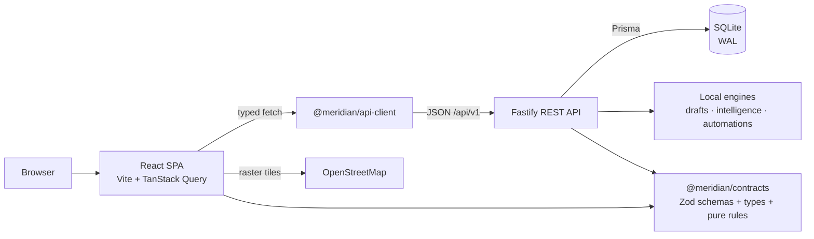

# Meridian CRM

[](https://github.com/StinkyCat0/meridiancrm/actions/workflows/ci.yml)
[](https://github.com/StinkyCat0/meridiancrm/actions/workflows/codeql.yml)

Meridian CRM is a boutique, API-first operations platform for local service businesses — hair and
nail salons, barbershops, HVAC crews, window cleaners, plumbers, landscapers, and the small teams
that run them. It keeps the books, the calendar, the customer conversation, and the money in one
place without turning a four-person shop into an enterprise software project. Customers, service
locations, a price book, dispatch, jobs, estimates, invoices, payments, expenses, and margins all
share one typed contract layer, so a native client can consume the same API rather than a second
backend.

Built for the day, not the quarter: dispatch the morning, collect the afternoon, and know which
service actually pays for itself.

## Features

**Operate the day**

- Dispatch board grouped by technician with utilization, unassigned work, and a route-optimized day
  per tech. The map plots service locations with coordinates on OpenStreetMap tiles.
- Calendar and job schedule with status, priority, assignee, recurrence, line items, tax, deposits,
  arrival and completion timestamps.
- Job lifecycle with explicit transitions
  `UNSCHEDULED → SCHEDULED → DISPATCHED → IN_PROGRESS → COMPLETED`, plus `CANCELED` and `NO_SHOW`,
  with the same side effects on every write path.
- Local, logged inbox for calls, texts, and emails. Messages are recorded against a customer,
  contact, or job — there is no carrier or mailbox connection, so nothing is sent or received.
- Local message drafts for reminders, follow-ups, quotes, payments, reviews, win-backs, and
  reschedules. A deterministic template engine builds the copy, and every draft carries a rationale.

**Grow the book**

- Customers typed residential, commercial, or property manager, with contacts, tags, ownership,
  archive/restore, and cross-links.
- Service locations with access notes, gate codes, on-site contacts, coordinates, and one primary
  location per customer.
- Customer 360 timeline that merges activities, logged communications, jobs, estimates, invoices,
  and payments in one feed.
- Price book with categories, units (visit, hour, sq ft, room, unit, item), duration, price, cost,
  and taxable flags.
- Estimates (`EST-1001`) that move draft → sent → approved and convert into jobs with line items
  intact.
- Invoices (`INV-1001`) generated from a job or customer, with a payment ledger, derived status and
  balance, and overdue flags.
- Leads pipeline with configurable stages, drag-and-drop boards, stage history, won/lost handling,
  and a deterministic 0–100 momentum score with an explainable breakdown.

**Run the business**

- Revenue and margin view: collected revenue, expenses, gross profit, monthly trend, service-line
  margins, technician revenue, top customers, and outstanding balances.
- Expense tracking by category, vendor, job, and team member, with an optional receipt URL.
- Automations: rules on job, quote, invoice, and customer events with conditions and contained
  actions (create a task, log a message, add a tag, request a review).
- Intelligence: deterministic, explainable recommendations for churn risk, no-show risk, upsells,
  collections, review requests, staffing, forecasts, quote follow-up, and route coverage. No
  external model is called.
- Team performance and workload: jobs scheduled/completed/canceled/no-show, revenue, margin,
  utilization, ratings, and today's capacity.
- Operations dashboard, global search, keyboard-first command palette (`Cmd/Ctrl+K`), and audit log.
- Email/password auth with rotating refresh cookies, invite-only team joins, and OWNER / ADMIN /
  MEMBER roles enforced server-side.
- REST API with OpenAPI docs, consistent error envelopes, Zod validation, and rate limiting.

## Local semantics

These boundaries are deliberate and visible in the UI:

- **Communications are logged, not delivered.** There is no SMS carrier, mailbox, or email
  provider. Logging a message writes a `Communication` row with `provider: "log"`; automation
  messages are also rows, with `provider: "automation"`.
- **Intelligence and drafts are local engines.** Recommendations and message copy come from
  deterministic rules and templates in `packages/contracts` and the API. No customer data leaves
  the server for a model provider.
- **Payments are a ledger.** Meridian records payments against invoices; it is not a payment
  processor and never moves money. `Payment` rows are the ledger, and `Invoice.amountPaid` is the
  denormalized total maintained in the same transaction.
- **Maps use OpenStreetMap.** The dispatch map loads raster tiles from
  `https://{s}.tile.openstreetmap.org/{z}/{x}/{y}.png` in the browser. No API key is required, and
  the browser discloses its IP address to OpenStreetMap while tiles load. Coordinates come from
  locations you enter; there is no geocoding service.
- **SQLite is single-writer.** WAL, a busy timeout, and an in-process per-workspace document-write
  queue keep concurrent creates fast and deterministic on one machine. Horizontal scaling needs
  Postgres.

## Quickstart

Requirements: Node.js 22+ and npm 10+.

```bash
npm install
cp apps/api/.env.example apps/api/.env
npm run db:setup
npm run dev
```

- Web app: http://localhost:5173
- API: http://localhost:4000/api/v1
- Interactive API docs: http://localhost:4000/docs
- Health: http://localhost:4000/api/v1/health

`npm run db:setup` generates the Prisma client, applies migrations, and seeds the `meridian-studio`
demo workspace. The seed deletes and recreates that workspace, so avoid running it against a
database you cannot restore.

Demo accounts, all with password `Meridian2026!`:

```text
demo@meridian.studio    OWNER
member@meridian.studio  ADMIN
```

The seed also creates member accounts for role checks and a realistic Austin, TX home-services book
with customers, locations, jobs, estimates, invoices, payments, expenses, logged communications, and
automation rules.

A `500 Internal Server Error` on sign-in means the request never reached a healthy API: the dev
server proxies `/api` to port 4000, so check that `npm run dev:api` (or `npm run dev`) is running
and that `npm run db:setup` completed without errors. `npm run dev` and `npm run dev:api` generate
the Prisma client on startup, so a first run does not need a separate `db:generate`.

Development runs over plain HTTP, where `NODE_ENV=development` leaves the refresh cookie non-Secure
by default. For a local production preview without TLS, set `COOKIE_SECURE=0`; behind TLS leave it
unset (defaults to `1` in production).

## Scripts

| Command                 | Purpose                                                     |
| ----------------------- | ----------------------------------------------------------- |
| `npm run dev`           | Run API and web together (concurrently).                    |
| `npm run dev:api`       | API only with watch mode.                                   |
| `npm run dev:web`       | Vite dev server only.                                       |
| `npm run build`         | Build API (`tsup`) and web (`vite build`).                  |
| `npm start`             | Start the built API.                                        |
| `npm test`              | Contracts + API integration tests (Vitest).                 |
| `npm run test:coverage` | Contracts tests plus API tests with the V8 coverage gate.   |
| `npm run verify`        | Tests plus both builds.                                     |
| `npm run verify:ci`     | Format check, coverage tests, both typechecks, both builds. |
| `npm run typecheck`     | TypeScript check for API and web.                           |
| `npm run format`        | Prettier write across the repo.                             |
| `npm run format:check`  | Prettier check; fails CI on unformatted files.              |
| `npm run db:setup`      | Generate client, migrate, seed the demo workspace.          |
| `npm run seed`          | Re-run the seed script.                                     |

## Architecture



- `apps/api` — Fastify 5, Prisma 6, SQLite, JWT auth, OpenAPI, dispatch routing, finance ledger,
  automation runner, local intelligence.
- `apps/web` — React 19, Vite, Tailwind CSS v4, TanStack Query, React Router, dnd-kit, Recharts,
  Leaflet.
- `packages/contracts` — Zod schemas, TypeScript types, status machines, invoice rules, message
  drafting, route optimization, momentum and scoring helpers shared by every client.
- `packages/api-client` — typed fetch wrapper over the REST API.

See [docs/ARCHITECTURE.md](docs/ARCHITECTURE.md) for the data model, write serialization, event
flow, and design decisions.

## Authentication

The API issues a 15-minute HS256 access JWT sent as `Authorization: Bearer <token>`. A rotating
opaque refresh token is stored hashed in the database (one row per session) and delivered as an
httpOnly, SameSite=Lax cookie scoped to `/api/v1/auth`. `POST /api/v1/auth/refresh` rotates that
token and returns a new access token; individual sessions are revocable. Passwords are hashed with
scrypt from `node:crypto`; there are no native dependencies.

## Quality gates

Every pull request runs:

- Prettier format check, contracts tests, API integration tests with the coverage floor, sequential
  API and web typechecks, and both production builds.
- CodeQL `security-extended` analysis for JavaScript/TypeScript.
- Dependabot alerts/updates, CodeQL `security-extended`, and a production-dependency audit at critical severity.
- `npm audit --omit=dev --audit-level=critical` for runtime dependencies.

The suite on this branch is verified by 90 API integration tests and 17 contract tests, with both
typechecks and builds passing.

## Deployment

Local Docker and single-machine deployments are the supported scope today. See
[docs/DEPLOYMENT.md](docs/DEPLOYMENT.md) for Compose, a Caddy TLS example, backups, and environment
variables. The API can serve the built web app with `SERVE_WEB=1`.

Docker Compose serves the app at http://localhost:4000 (loopback-only), with `COOKIE_SECURE=0`
correct for plain HTTP localhost. Migrations run automatically but seeding does not. The optional
demo seed is destructive; never run it against real data:

```bash
JWT_SECRET="$(openssl rand -base64 48)" docker compose run --rm meridian npx tsx prisma/seed.ts
```

Details are in [docs/DEPLOYMENT.md](docs/DEPLOYMENT.md#optional-load-the-demo-workspace).

## Documentation

- [Architecture](docs/ARCHITECTURE.md)
- [API reference](docs/API.md)
- [Status](docs/STATUS.md)
- [Roadmap](docs/ROADMAP.md)
- [Decisions](docs/DECISIONS.md)
- [Mobile strategy](docs/MOBILE.md)
- [Deployment](docs/DEPLOYMENT.md)
- [Security](SECURITY.md)
- [Contributing](CONTRIBUTING.md)
- [Changelog](CHANGELOG.md)

## License

Proprietary. Copyright (c) 2026 Meridian Studios. All rights reserved. See [LICENSE](LICENSE).
