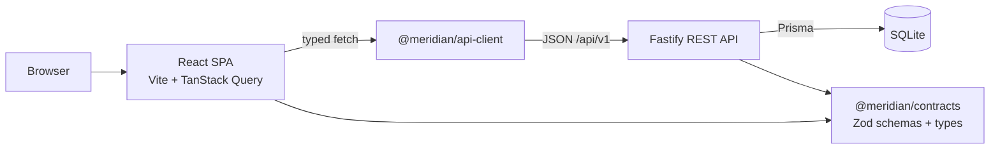

# Meridian CRM

[](https://github.com/StinkyCat0/meridiancrm/actions/workflows/ci.yml)

Meridian CRM is a boutique, API-first CRM for service businesses — window cleaners, HVAC crews,
utilities, hair and nail salons, and the teams that dispatch them. It keeps the pipeline legible
while staying close to the day: customers, service locations, a price book, scheduled jobs,
estimates, invoices, and the money still owed. It is built as a TypeScript monorepo with a shared
contract layer, so a native mobile client consumes the same API rather than a second backend.

## Features

- Email/password auth with rotating refresh cookies, workspace registration, and invite-only joins.
- Multi-tenant workspaces with OWNER / ADMIN / MEMBER roles enforced server-side.
- Customers and contacts with tags, ownership, archive/restore, notes, and cross-links. Customers
  are typed residential, commercial, or property manager.
- Service locations per customer: address, access notes, gate codes, on-site contact, and a single
  primary location.
- Service price book with categories, units (visit, hour, sq ft, room, unit, item), duration, price
  in cents, and taxable flags.
- Jobs / work orders with numbering (`JOB-1001`), scheduling windows, priority, assignee, recurrence,
  line items, tax, deposits, and a status lifecycle with arrival and completion timestamps.
- Estimates (`EST-1001`) that move draft → sent → approved and convert into jobs with their line
  items intact.
- Invoices (`INV-1001`), optionally generated from a job, with partial payments, derived balances,
  and overdue flags.
- Operations dashboard strip: today's schedule, completed work, unscheduled and unassigned jobs,
  booked value, receivables, and open estimates.
- Multiple pipelines with configurable stages, drag-and-drop deal boards, stage history, and
  won/lost handling.
- Deterministic 0-100 deal momentum score with an explainable breakdown.
- Activities (note, call, email, meeting, task) linked to companies, contacts, and deals.
- Dashboard with pipeline value, win rate, average deal size, revenue trend, stage distribution,
  activity mix, and momentum bands.
- Global search and a keyboard-first command palette (`Cmd/Ctrl+K`).
- Team management: members, role changes, revocable expiring invites, audit log.
- Installable PWA; documented plan for an Expo/React Native client.
- REST API with OpenAPI docs, consistent error envelopes, Zod validation, and rate limiting.

## Quickstart

Requirements: Node.js 22+ and npm 10+.

```bash
npm install
cp apps/api/.env.example apps/api/.env
npm run db:setup
npm run dev
```

- Web app: http://localhost:5173
- API: http://localhost:4000/api/v1
- Interactive API docs: http://localhost:4000/docs
- Health: http://localhost:4000/api/v1/health

`npm run db:setup` runs Prisma migrations and seeds a demo workspace. The seed deletes and recreates
the `meridian-studio` demo workspace, so avoid running it against a database you cannot restore.

Demo account:

```text
demo@meridian.studio
Meridian2026!
```

Development runs over plain HTTP, where `NODE_ENV=development` leaves the refresh cookie non-Secure
by default. For a local production preview without TLS, set `COOKIE_SECURE=0`; behind TLS leave it
unset (defaults to `1` in production).

## Scripts

| Command              | Purpose                                                    |
| -------------------- | ---------------------------------------------------------- |
| `npm run dev`        | Run API and web together (concurrently).                   |
| `npm run dev:api`    | API only with watch mode.                                  |
| `npm run dev:web`    | Vite dev server only.                                      |
| `npm run build`      | Build API (`tsup`) and web (`vite build`).                 |
| `npm start`          | Start the built API.                                       |
| `npm test`           | Contracts + API integration tests (Vitest).                 |
| `npm run verify`     | Tests plus both builds; the CI gate.                       |
| `npm run typecheck`  | TypeScript check for API and web.                          |
| `npm run db:setup`   | Apply migrations and seed the demo workspace.              |
| `npm run seed`       | Re-run the seed script.                                    |
| `npm run format`     | Prettier across the repo.                                  |

## Architecture



- `apps/api` — Fastify 5, Prisma 6, SQLite, JWT auth, OpenAPI.
- `apps/web` — React 19, Vite, Tailwind CSS v4, TanStack Query, React Router, dnd-kit, Recharts.
- `packages/contracts` — Zod schemas, TypeScript types, and the momentum calculator shared by every
  client.
- `packages/api-client` — typed fetch wrapper over the REST API.

See [docs/ARCHITECTURE.md](docs/ARCHITECTURE.md) for multi-tenancy, auth, and design decisions.

## Authentication

The API issues a 15-minute HS256 access JWT sent as `Authorization: Bearer <token>`. A rotating
opaque refresh token is stored hashed in the database (one row per session) and delivered as an
httpOnly, SameSite=Lax cookie scoped to `/api/v1/auth`. `POST /api/v1/auth/refresh` rotates that
token and returns a new access token; individual sessions are revocable. Passwords are hashed with
scrypt from `node:crypto`; there are no native dependencies.

## Deployment

Local Docker and single-machine deployments are the supported scope today. See
[docs/DEPLOYMENT.md](docs/DEPLOYMENT.md) for Compose, a Caddy TLS example, backups, and environment
variables. The API can serve the built web app with `SERVE_WEB=1`.

Docker Compose serves the app at http://localhost:4000 (loopback-only), with `COOKIE_SECURE=0`
correct for plain HTTP localhost. Migrations run automatically but seeding does not. The optional
demo seed is destructive; never run it against real data:

```bash
JWT_SECRET="$(openssl rand -base64 48)" docker compose run --rm meridian npx tsx prisma/seed.ts
```

Details are in [docs/DEPLOYMENT.md](docs/DEPLOYMENT.md#optional-load-the-demo-workspace).

## Documentation

- [Architecture](docs/ARCHITECTURE.md)
- [API reference](docs/API.md)
- [Mobile strategy](docs/MOBILE.md)
- [Deployment](docs/DEPLOYMENT.md)
- [Roadmap](docs/ROADMAP.md)
- [Decisions](docs/DECISIONS.md)
- [Security](SECURITY.md)
- [Contributing](CONTRIBUTING.md)
- [Changelog](CHANGELOG.md)

## License

Proprietary. Copyright (c) 2026 Meridian Studios. All rights reserved. See [LICENSE](LICENSE).
