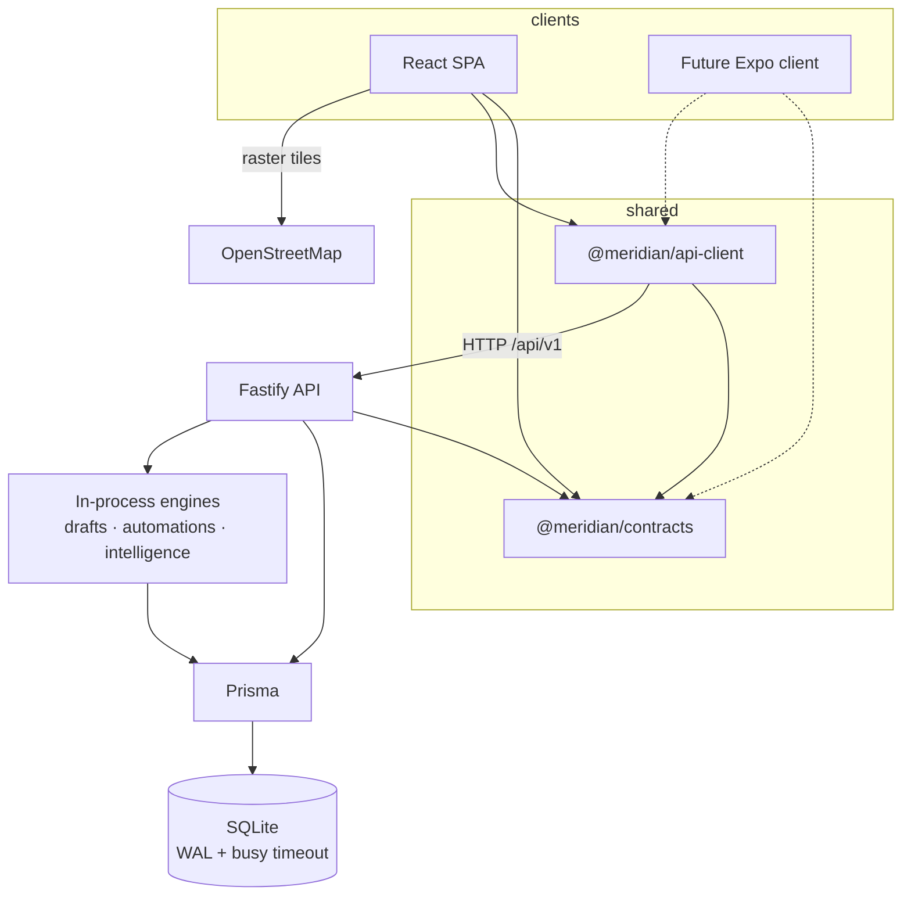
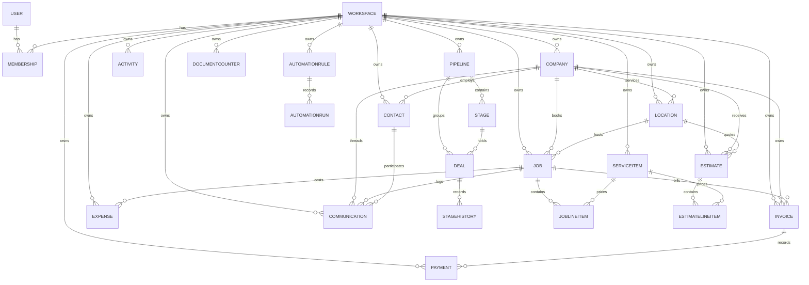
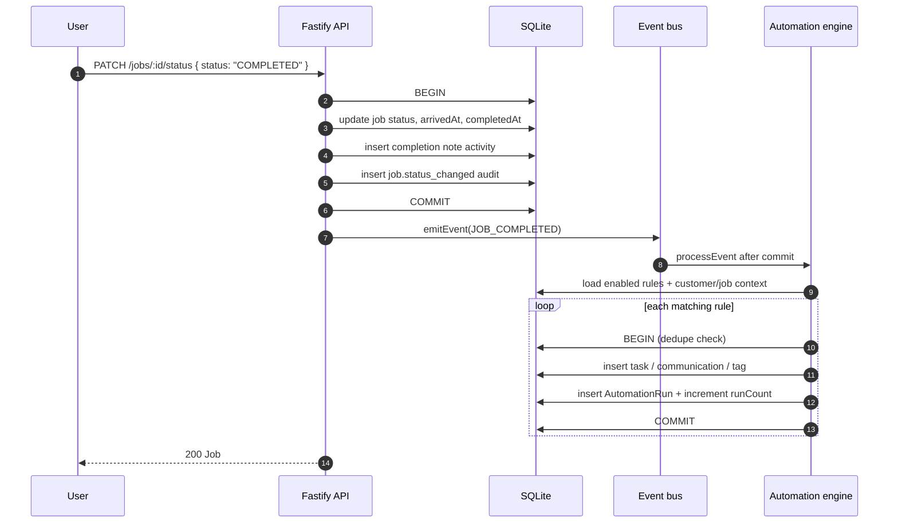

# Architecture

## Shape

A four-layer monorepo. Each layer has one job, and dependencies point inward.

| Layer      | Location              | Responsibility                                                                                                   |
| ---------- | --------------------- | ---------------------------------------------------------------------------------------------------------------- |
| Contracts  | `packages/contracts`  | Zod schemas, shared types, enums, status machines, invoice rules, drafting, route optimization, scoring.         |
| API client | `packages/api-client` | Typed fetch calls; the only place the web (or a future native app) talks to the network.                         |
| API        | `apps/api`            | Fastify routes, auth, tenancy, Prisma data access, dispatch routing, ledger, automations, intelligence, OpenAPI. |
| Web        | `apps/web`            | React SPA: routing, TanStack Query cache, Tailwind UI, Leaflet map.                                              |



The web app never imports database types or re-implements validation. If a shape needs to change, it
changes in `packages/contracts` once and TypeScript reports every stale call site. Status machines
and pure helpers live in contracts so the server, the SPA, and a future native client agree on
transitions instead of duplicating them.

## Module map

| Module             | Key files                                                                                                           | Responsibility                                                                     |
| ------------------ | ------------------------------------------------------------------------------------------------------------------- | ---------------------------------------------------------------------------------- |
| Auth and tenancy   | `src/lib/auth.ts`, `src/routes/auth.ts`, `src/routes/workspace.ts`                                                  | JWT access tokens, rotating refresh rows, memberships, roles, invites, audit.      |
| CRM                | `src/routes/{companies,contacts,deals,pipelines,activities,insights}.ts`                                            | Customers, contacts, pipeline, stage history, activities, dashboard, search.       |
| Service operations | `src/lib/service-ops.ts`, `src/lib/job-status.ts`, `src/routes/{locations,services,jobs,estimates,invoices,ops}.ts` | Price book, scheduling, jobs, quotes, invoices, document numbering, job lifecycle. |
| Dispatch           | `src/routes/dispatch.ts`, `packages/contracts/src/route.ts`                                                         | Board, mappable stops, route optimization, bulk assignment.                        |
| Inbox and timeline | `src/routes/communications.ts`, `src/routes/timeline.ts`, `packages/contracts/src/drafts.ts`                        | Logged calls/texts/emails, threads, drafts, customer 360 feed.                     |
| Money              | `src/routes/finance.ts`, `src/routes/invoices.ts`, `packages/contracts/src/finance.ts`                              | Payment ledger, expenses, margins, summaries.                                      |
| Automation         | `src/lib/automation.ts`, `src/lib/events.ts`, `src/routes/automations.ts`                                           | Domain events, rule evaluation, contained actions, run log, due sweep.             |
| Intelligence       | `src/lib/intelligence.ts`, `src/routes/intelligence.ts`                                                             | Deterministic recommendations, forecast, health, brief.                            |
| Team               | `src/routes/team.ts`                                                                                                | Performance and daily workload per member.                                         |
| Frontend           | `apps/web/src/features/*`, `apps/web/src/components/*`                                                              | Operation, growth, and admin surfaces plus shared UI primitives.                   |

## Data model



Core records: `User`, `Workspace`, `Membership`, `RefreshToken`, `Company` (presented as the
customer), `Contact`, `Location`, `ServiceItem`, `Job`, `JobLineItem`, `Estimate`,
`EstimateLineItem`, `Invoice`, `Payment`, `Expense`, `Communication`, `AutomationRule`,
`AutomationRun`, `DocumentCounter`, `Pipeline`, `Stage`, `Deal`, `StageHistory`, `Activity`,
`Invite`, `AuditLog`. SQLite has no native enums, so roles, statuses, channels, categories, and the
other service enums are stored as text and validated at the API boundary with Zod.

Money is integer cents (`Deal.value`, `Job.total`, `Invoice.amount`, `Payment.amount`,
`Expense.amount`, `ServiceItem.price` and `cost`) with an ISO currency code on the workspace. Tax
rates are stored as basis points and exposed as percentages. Document numbers (`JOB-1001`,
`EST-1001`, `INV-1001`) are allocated per workspace from `DocumentCounter`, keyed by
`(workspaceId, prefix)`. Tags are a JSON-encoded string array.

### Payment ledger and invoice state

`Payment` is the ledger: one row per recorded receipt or adjustment, with `invoiceId`, `amount`,
`method`, optional `reference`, `receivedAt`, and `recordedBy`. Negative amounts are adjustments
written with method `ADJUSTMENT`. `Invoice.amountPaid` is a denormalized sum maintained in the same
transaction that writes the ledger row, so list and summary queries stay cheap. Derived status — the
payment endpoints and `PATCH` without an explicit status — is a pure function of `amount` and
`amountPaid`; explicit status changes are validated against the transition table. Overdue is derived
from `balance > 0` and `dueAt` and is never stored. The shared rules live in
`packages/contracts/src/invoice-rules.ts`.

### Communications

`Communication` stores channel (`CALL`, `SMS`, `EMAIL`), direction, status, intent, sentiment, subject,
body, optional customer/contact/job links, author, `provider`, `externalId`, `aiGenerated`,
`aiRationale`, `readAt`, and `occurredAt`. There is no carrier integration: locally logged rows use
`provider: "log"` and automation rows use `provider: "automation"`, both with `externalId: null`.
`aiGenerated` marks copy produced by the local template engine, not by a remote model.

### Automation

`AutomationRule` stores the trigger, JSON conditions, JSON actions, enabled flag, run count, and last
run time. `AutomationRun` records one evaluation per rule and entity with `SUCCESS`, `SKIPPED`, or
`FAILED` and a short detail string. Run history is deleted with its rule. `DocumentCounter` is a
composite-primary-key sequence row; it survives document deletes so numbers are never reused.

Jobs, invoices, estimates, and companies hard-delete when permitted. Locations, services, companies,
and contacts archive and restore; `?permanent=true` (ADMIN+) hard-deletes where the schema allows.
`StageHistory` is append-only. A customer has at most one primary location, maintained inside a
transaction that clears competitors and promotes a replacement when the primary is cleared or
archived.

## SQLite write serialization

SQLite has one writer. The app leans on four layers rather than pretending otherwise:

1. **Pragmas at boot** (`src/lib/db.ts`): `journal_mode=WAL`, `busy_timeout=5000`, and
   `foreign_keys=ON`. WAL lets readers proceed while a write transaction is open; the busy timeout
   turns lock contention into a short wait instead of an immediate error. The configuration is
   idempotent and logs failure rather than blocking boot.
2. **Short interactive transactions** with Prisma `maxWait` and `timeout` set to 20 seconds on
   document writes. Status changes, ledger entries, primary-location changes, and automation runs
   each commit atomically with their side effects.
3. **Per-workspace document queue** (`createWithDocumentNumber` in `src/lib/service-ops.ts`). A
   promise chain serializes job, estimate, and invoice creation for one workspace in-process, then
   allocates the next number from `DocumentCounter` inside the create transaction. Unique conflicts
   and lock errors (`P2002`, `P2010`, `P2034`, `P2028`, "database is locked", socket timeout) are
   retried with a short backoff. This is deliberately per-process: multiple API instances would need
   a database sequence or a Postgres migration.
4. **Deterministic ordering.** List queries append `id` to the `orderBy`, because SQLite timestamps
   have one-second resolution and non-unique sorts make offset pagination skip or repeat rows.

Multi-instance deployment is not supported. Postgres is a provider swap plus migration review, not
an application rewrite; the per-workspace queue is the one place that assumes a single process.

## Event flow

Domain events are triggered by core writes: job created, job status changed to completed/canceled/
no-show, quote sent/approved, customer created, and invoice overdue or appointment upcoming from the
admin-triggered due sweep. Events are emitted **after** the writing transaction commits, because the
automation engine writes its run log through the global Prisma client and must not contend with the
open SQLite transaction.

`emitEvent` deliberately swallows automation failures after logging them: an automation problem can
never fail the write that triggered it. `processEvent` loads enabled rules for the trigger, builds one
event context from workspace-scoped rows, and runs each rule in its own transaction with a 24-hour
dedupe check on `(rule, trigger, entity)`. A rule writes one `AutomationRun` and, when conditions
match, executes its contained actions: create a task, log a message (optionally with locally drafted
copy), add a tag, or request a review (a logged review message plus a follow-up task). One failing
rule never blocks its siblings; a thrown rule error is recorded as `FAILED`.



The order matters: the job response never waits on automation delivery, and a failed rule cannot roll
back a completed job. The same `applyJobStatus` helper is used by `PATCH /jobs/:id`,
`PATCH /jobs/:id/status`, and dispatch assignment, so timestamps, activities, audits, and events
cannot diverge between write paths. `PATCH /jobs/:id` collects events and emits them after its
transaction; `PATCH /jobs/:id/status` does the same.

## Local drafts and intelligence

Both features are deterministic and run in-process:

- **Drafts** (`packages/contracts/src/drafts.ts`) compose a greeting, intent-specific body, sign-off,
  and email subject from customer, contact, business type, appointment, job, service, balance, and
  service area. The rationale states which signals were used and that no customer data left the
  server. The UI presents the result as an assistant draft until an agent reviews and logs it.
- **Intelligence** (`src/lib/intelligence.ts`) queries workspace rows, scores opportunities with
  fixed rules, sorts by severity and value, and caps per-kind counts. It returns an explainable
  `rationale` on every recommendation, a 30-day forecast with named assumptions and a confidence
  band, and a health snapshot. There is no model call, embedding store, background job, or external
  enrichment, so the same data produces the same summary.

Automation `SEND_MESSAGE` and `REQUEST_REVIEW` reuse the draft engine and write a locally logged
communication row. "Sent" in this product means recorded in the workspace, not delivered by a
carrier.

## Map tiles

The dispatch map uses Leaflet with OpenStreetMap raster tiles
(`https://{s}.tile.openstreetmap.org/{z}/{x}/{y}.png`) loaded directly by the browser. There is no API
key, tile proxy, or geocoding service. Loading tiles discloses the browser's IP address and the
approximate viewed area to OpenStreetMap; the app shows the required attribution and falls back to a
"tiles unavailable" notice while keeping stops visible. Only locations with latitude and longitude
appear; the depot is workspace configuration, not an address lookup.

## Multi-tenancy

Every top-level tenant record carries `workspaceId` (stages inherit tenancy through their pipeline,
and automation runs through their rule). Payment and communication queries also scope their joins so
a crafted invoice, customer, contact, or job id cannot cross workspaces. Isolation is enforced in
three places:

1. **Authentication** loads the access token's `wid` claim, then loads a fresh `Membership` row. A
   deleted or demoted membership invalidates the session on the next request.
2. **Every query** filters by `workspaceId` from the authenticated context. Route code never accepts
   a workspace id from the client.
3. **Ownership checks** before mutations: `findFirst({ where: { id, workspaceId } })`, never
   `findUnique({ where: { id } })`, so cross-tenant probing returns 404 consistently.

Role checks use a hierarchy (`MEMBER < ADMIN < OWNER`) in `packages/contracts`. Reading is available
to every member. Workspace settings, member changes, invites, audit, permanent deletion, pipeline and
stage management, automation rule changes and the due sweep, expense mutations, and communication
deletion are ADMIN+. The member role endpoint accepts only ADMIN/MEMBER, and an OWNER's role can only
be changed by an OWNER. The last OWNER cannot be removed or demoted, and members cannot remove
themselves.

## Authentication flow

```text
register/login
  -> verify scrypt password hash
  -> issue access JWT (15m, HS256, issuer meridian-crm) + opaque refresh token
  -> store SHA-256(refresh) in RefreshToken with expiry, return cookie

request
  -> Authorization: Bearer <jwt>
  -> verify signature/issuer/audience
  -> load membership for token workspace
  -> attach { userId, workspaceId, role } to request

refresh
  -> read httpOnly cookie
  -> look up hash, reject revoked/expired
  -> atomically revoke old row and create a new one (rotation)
  -> reused revoked token revokes the token family
  -> set new cookie, return new access token

logout
  -> revoke current refresh row, clear cookie
```

The refresh cookie is `httpOnly`, `SameSite=Lax`, scoped to `/api/v1/auth`, and `Secure` by default
in production. `COOKIE_SECURE=0` exists only for plain-HTTP local previews; behind TLS keep it on.
Password hashing uses scrypt with a per-password salt and stored cost, compared with
`timingSafeEqual`. Refresh tokens are random 384-bit values; only their hashes are stored.

## API conventions

- Base path `/api/v1`; JSON request and response bodies.
- Success: resources directly, lists as `{ data, meta }` with
  `meta = { page, pageSize, total, totalPages }`. A few aggregate endpoints (timeline, dispatch,
  finance summary, intelligence) return their contract object directly.
- Errors: `{ error: { code, message, details? } }` with stable codes (`UNAUTHORIZED`, `FORBIDDEN`,
  `NOT_FOUND`, `VALIDATION_ERROR`, `CONFLICT`, `RATE_LIMITED`, `INTERNAL`, `BAD_REQUEST`).
- Validation at the edge with Zod; handlers receive parsed, typed input.
- Mutations emit an audit entry when they are privileged or affect tenant structure, money, or the
  job lifecycle.
- OpenAPI is generated from route schemas and served at `/docs`; JSON at `/docs/json`.

Rate limits: 600 requests/minute per client globally, with stricter per-route limits on auth
endpoints (login is capped at 10/minute). Responses include the standard `x-ratelimit-*` headers.
`X-Forwarded-*` is only used for client identity when `TRUST_PROXY` is configured; it defaults to
`false`.

## Momentum score

`computeMomentum` in `packages/contracts` is deterministic and shared, so the server and any client
always display the same number. Components (0-100):

| Component      | Max | Rule                                                               |
| -------------- | --- | ------------------------------------------------------------------ |
| Last touch     | 40  | 0d-2d: 40, 3d-7d: 32, 8d-14d: 22, 15d-30d: 12, older: 4, never: 0. |
| Engagement     | 20  | 6+ activities in 30d: 20, 3+: 14, 1+: 7, none: 0.                  |
| Stage velocity | 25  | Within stage target: 25, within 2x: 15, beyond: 5.                 |
| Close plan     | 15  | No date: 7, <=7d: 15, <=30d: 10, later: 6, overdue: 0.             |

Bands: `hot` >= 70, `warm` >= 40, otherwise `cold`. Won deals short-circuit to 100; lost to 0.
The API returns the component breakdown with every deal, so the UI can explain the score instead of
showing a black box. Service intelligence uses the same principle: every recommendation carries its
rationale.

## Why a contracts package

- One source of truth for request/response shapes and enums across API, web, and future mobile.
- Zod schemas parse at the boundary and generate types via `z.infer`, avoiding drift between
  validation and TypeScript types.
- Pure helpers — momentum, invoice rules, job transitions, route optimization, message drafts — are
  portable and testable without a server.
- Packages export TypeScript source directly. Vite and tsup consume it without a build step, keeping
  the inner loop fast. Publishing them separately would add ceremony without a consumer.

## Frontend state

TanStack Query owns server state; React state owns ephemeral UI state (open dialogs, drag preview,
map instance). Mutations invalidate every query family that embeds the changed names or totals, so a
customer rename refreshes schedule, quotes, invoices, and the ops strip. Lists use server pagination
with a visible range; detail sublists surface loading and error states instead of empty states. A 401
triggers one refresh attempt and then a clean logout.

## Performance decisions

- SQLite with Prisma and composite indexes on `(workspaceId, ...)` for every list query, including
  `Job(workspaceId, locationId)`, `Invoice(workspaceId, jobId)`, and `Invoice(workspaceId, createdAt)`.
- Offset pagination capped at 100 rows, with server-side search using escaped `LIKE` terms and an
  `id` tiebreaker.
- Dashboard, finance, intelligence, and team aggregations are computed in one request from indexed
  rows; no client-side joins.
- The payment ledger keeps summary queries to one indexed table plus the invoice relation;
  `amountPaid` is the denormalized total.
- Route optimization is capped (nearest neighbour plus at most four 2-opt passes on 25 stops) so a
  pathological day cannot pin a request thread.
- The web build is static and served by Fastify when `SERVE_WEB=1`, so production can be one process.
- The PWA precaches the app shell; API responses are not cached for offline reads in the browser.

## File map

```text
apps/api/
  prisma/schema.prisma, migrations/, seed.ts
  src/app.ts             Fastify assembly, plugins, OpenAPI metadata
  src/server.ts          process lifecycle
  src/config.ts          env parsing and production guards
  src/lib/auth.ts        JWT, refresh rows, membership and role checks
  src/lib/db.ts          Prisma client, WAL/busy-timeout/foreign-key pragmas
  src/lib/http.ts        error envelope, pagination, parsing helpers
  src/lib/audit.ts       audit writer
  src/lib/service-ops.ts document numbering queue, pricing, totals, invoice state
  src/lib/job-status.ts  job transition table and lifecycle side effects
  src/lib/events.ts      in-process domain event boundary
  src/lib/automation.ts  rule evaluation, actions, run log, due sweep
  src/lib/intelligence.ts recommendation, forecast, and brief builders
  src/routes/*.ts        auth, workspace, CRM, locations, services, jobs, estimates,
                         invoices, ops, communications, timeline, dispatch, finance,
                         automations, intelligence, team
apps/web/
  src/features/{dashboard,dispatch,calendar,schedule,inbox,revenue,automations,
                intelligence,team,companies,contacts,deals,estimates,invoices,
                services,activities,settings}/
  src/components/{layout,ui,command}/
packages/contracts/src/
  enums, entities, service, finance, communications, dispatch, automation,
  intelligence, team, timeline, drafts, invoice-rules, route, momentum, insights
packages/api-client/src/ typed fetch client
infra/health-worker/    optional external uptime probe
```
