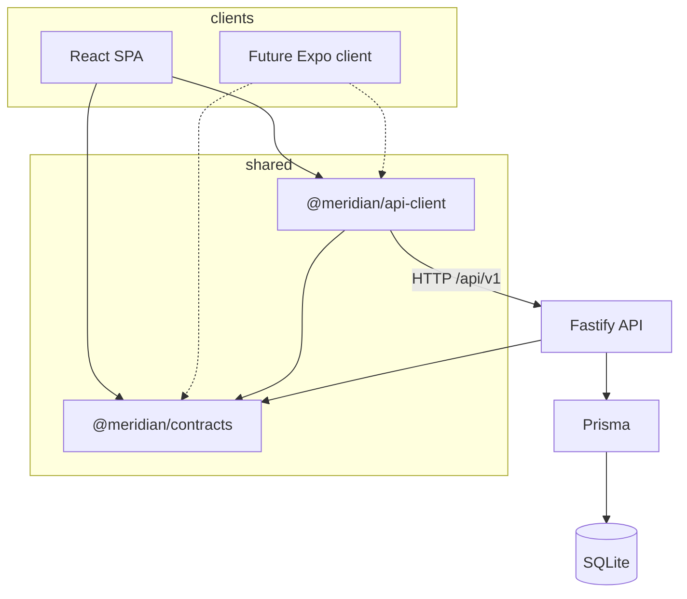
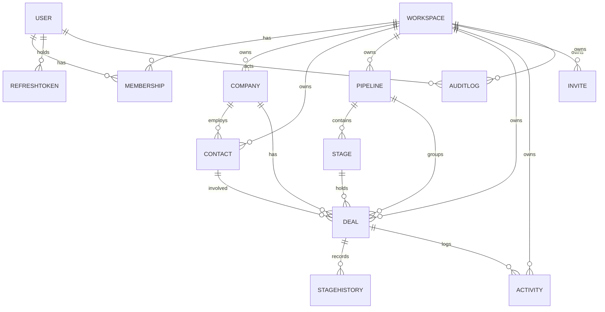

# Architecture

## Shape

A four-layer monorepo. Each layer has one job, and dependencies point inward.

| Layer        | Location                | Responsibility                                                     |
| ------------ | ----------------------- | ------------------------------------------------------------------ |
| Contracts    | `packages/contracts`    | Zod schemas, shared types, enums, momentum scoring.                |
| API client   | `packages/api-client`   | Typed fetch calls; the only place the web (or a future native app) talks to the network. |
| API          | `apps/api`              | Fastify routes, auth, tenancy, Prisma data access, OpenAPI.        |
| Web          | `apps/web`              | React SPA: routing, TanStack Query cache, Tailwind UI.             |



The web app never imports database types or re-implements validation. If a shape needs to change, it
changes in `packages/contracts` once and TypeScript reports every stale call site.

## Data model



Core records: `User`, `Workspace`, `Membership`, `RefreshToken`, `Company`, `Contact`, `Pipeline`,
`Stage`, `Deal`, `StageHistory`, `Activity`, `Invite`, `AuditLog`. SQLite has no native enums, so
role, stage kind, and activity type are stored as text and validated at the API boundary with Zod.

Money is stored as integer cents (`Deal.value`) with an ISO currency code. Tags are a JSON-encoded
string array. Companies and contacts are archived by default and restored through a dedicated
endpoint; `?permanent=true` (ADMIN+) hard-deletes them. Deals hard-delete immediately and require
ADMIN. `StageHistory` is append-only and records every stage transition.

## Multi-tenancy

Every top-level tenant record carries `workspaceId` (stages inherit tenancy through their pipeline).
Isolation is enforced in three places:

1. **Authentication** loads the access token's `wid` claim, then loads a fresh `Membership` row. A
   deleted or demoted membership invalidates the session on the next request.
2. **Every query** filters by `workspaceId` from the authenticated context. Route code never accepts
   a workspace id from the client.
3. **Ownership checks** before mutations: `findFirst({ where: { id, workspaceId } })`, never
   `findUnique({ where: { id } })`, so cross-tenant probing returns 404 consistently.

Role checks use a small hierarchy (`MEMBER < ADMIN < OWNER`) in `packages/contracts`. Reading is
available to every member; workspace settings, member changes, invites, and audit are ADMIN+. The
member role endpoint accepts only ADMIN/MEMBER, and an OWNER's role can only be changed by an OWNER;
ownership transfer is not exposed. The last OWNER cannot be removed or demoted, and members cannot
remove themselves.

## Authentication flow

```text
register/login
  -> verify scrypt password hash
  -> issue access JWT (15m, HS256, issuer meridian-crm) + opaque refresh token
  -> store SHA-256(refresh) in RefreshToken with expiry, return cookie

request
  -> Authorization: Bearer <jwt>
  -> verify signature/issuer/audience
  -> load membership for token workspace
  -> attach { userId, workspaceId, role } to request

refresh
  -> read httpOnly cookie
  -> look up hash, reject revoked/expired
  -> atomically revoke old row and create a new one (rotation)
  -> reused revoked token revokes the token family
  -> set new cookie, return new access token

logout
  -> revoke current refresh row, clear cookie
```

The refresh cookie is `httpOnly`, `SameSite=Lax`, scoped to `/api/v1/auth`, and `Secure` by default
in production. `COOKIE_SECURE=0` exists only for plain-HTTP local previews; behind TLS keep it on.
The cookie survives reloads; on load the web client calls `/auth/refresh` to obtain a fresh access
token instead of persisting one.

Password hashing uses scrypt with per-password salt and a stored cost parameter, compared with
`timingSafeEqual`. Refresh tokens are random 384-bit values; only their hashes are stored, so a
database leak does not yield usable sessions.

## API conventions

- Base path `/api/v1`; JSON request and response bodies.
- Success: resources directly, lists as `{ data, meta }` with
  `meta = { page, pageSize, total, totalPages }`.
- Errors: `{ error: { code, message, details? } }` with stable codes (`UNAUTHORIZED`, `FORBIDDEN`,
  `NOT_FOUND`, `VALIDATION_ERROR`, `CONFLICT`, `RATE_LIMITED`, `INTERNAL`, `BAD_REQUEST`).
- Validation at the edge with Zod; handlers receive parsed, typed input.
- Mutations emit an audit entry when they are privileged or affect tenant structure.
- OpenAPI is generated from route schemas and served at `/docs`; JSON at `/docs/json`.

Rate limits: 600 requests/minute per client globally, with stricter per-route limits on auth
endpoints (login is capped at 10/minute). Responses include the standard `x-ratelimit-*` headers.
`X-Forwarded-*` is only used for client identity when `TRUST_PROXY` is configured; it defaults to
`false`.

## Momentum score

`computeMomentum` in `packages/contracts` is deterministic and shared, so the server and any client
always display the same number. Components (0-100):

| Component       | Max | Rule                                                                 |
| --------------- | --- | -------------------------------------------------------------------- |
| Last touch      | 40  | 0d-2d: 40, 3d-7d: 32, 8d-14d: 22, 15d-30d: 12, older: 4, never: 0.    |
| Engagement      | 20  | 6+ activities in 30d: 20, 3+: 14, 1+: 7, none: 0.                     |
| Stage velocity  | 25  | Within stage target: 25, within 2x: 15, beyond: 5.                    |
| Close plan      | 15  | No date: 7, <=7d: 15, <=30d: 10, later: 6, overdue: 0.                |

Bands: `hot` >= 70, `warm` >= 40, otherwise `cold`. Won deals short-circuit to 100; lost to 0.
The API returns the component breakdown with every deal, so the UI can explain the score instead of
showing a black box.

## Why a contracts package

- One source of truth for request/response shapes and enums across API, web, and future mobile.
- Zod schemas parse at the boundary and generate types via `z.infer`, avoiding drift between
  validation and TypeScript types.
- The momentum util is pure and portable; a native client can recompute it offline.
- Packages export TypeScript source directly. Vite and tsup consume it without a build step, keeping
  the inner loop fast. Publishing them separately would add ceremony without a consumer.

## Frontend state

TanStack Query owns server state; React state owns ephemeral UI state (open dialogs, drag preview).
Mutations invalidate the query keys they affect, so a stage move refreshes the board, deal detail,
and dashboard without a full page reload. A 401 triggers one refresh attempt and then a clean logout.

## Performance decisions

- SQLite with Prisma and composite indexes on `(workspaceId, ...)` for every list query.
- Offset pagination capped at 100 rows, with server-side search using escaped `LIKE` terms.
- Dashboard aggregation is computed in one request from indexed rows; no client-side joins.
- Access tokens are short-lived but refresh is a single round trip; the web app refreshes lazily.
- The web build is static and served by Fastify when `SERVE_WEB=1`, so production can be one process.
- The PWA precaches the app shell; API responses are not cached for offline reads in the browser.

## File map

```text
apps/api/
  prisma/schema.prisma, migrations/, seed.ts
  src/app.ts            Fastify assembly, plugins, OpenAPI metadata
  src/server.ts         process lifecycle
  src/config.ts         env parsing and production guards
  src/lib/{auth,db,http,audit}.ts
  src/routes/*.ts       auth, workspace, companies, contacts, deals, pipelines, activities, insights
apps/web/
  src/                  routes, components, lib/api.ts, design tokens
packages/contracts/src/ enums, entities, auth, insights, momentum
packages/api-client/src/ typed fetch client
infra/health-worker/    optional external uptime probe
```
