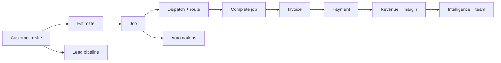

# Meridian CRM walkthrough

This is the full guided tour for the shipped application. The in-app **Walkthrough** page condenses
it into seven screens and is reachable from the user menu, the command palette, or the first-sign-in
toast. This document adds the seeded records, edge cases, and troubleshooting behind those screens.

It follows the seeded **Meridian Home Services** workspace through one complete operating cycle: a
customer and site, a priced quote, the job, the dispatch day, the invoice, the payment, and the
reporting that follows. Every screen named here exists in the demo seed, so you can follow the whole
tour without inventing data.

The tour takes about 30–45 minutes. Run it against a disposable local database, not against real
data.

## Before you start

Requirements: Node.js 22+ and npm 10+.

```bash
npm install
cp apps/api/.env.example apps/api/.env
npm run db:setup
npm run dev
```

Open http://localhost:5173. The API runs at http://localhost:4000/api/v1, interactive API docs at
http://localhost:4000/docs, and health at http://localhost:4000/api/v1/health.

`npm run db:setup` deletes and recreates the `meridian-studio` workspace. Never run it against a
database you cannot restore.

Sign in with the demo owner:

```text
Email:    demo@meridian.studio
Password: Meridian2026!
```

The login screen has a **Demo access** control that copies these credentials. Other seeded accounts
are useful for role checks. All use the same password.

| Account                  | Role   | Use it to see                                     |
| ------------------------ | ------ | ------------------------------------------------- |
| `demo@meridian.studio`   | OWNER  | Everything, including workspace administration    |
| `member@meridian.studio` | ADMIN  | Admin-gated team, pipeline, automation and audit  |
| `maya@meridian.studio`   | MEMBER | Member read-only behavior and assigned field work |
| `chris@meridian.studio`  | MEMBER | A second technician lane on dispatch              |
| `sofia@meridian.studio`  | MEMBER | A third technician lane on dispatch               |

The seed places jobs relative to the moment you run it. Jobs marked for today stay on today, so the
day-of-operations screens have live data whenever you start the tour.

### Local semantics you will see

These are product boundaries, not missing configuration:

- **Communications are logged, not delivered.** There is no SMS carrier, mailbox, or email provider.
  Logging a message writes a row and the UI says so. Automation messages are rows too.
- **Drafts and intelligence are local engines.** Templates and deterministic rules produce message
  copy, recommendations, health signals, and forecasts. No customer data leaves the server for a
  model provider.
- **Payments are a ledger.** Meridian records receipts and adjustments against invoices. It is not a
  payment processor and never moves money.
- **Maps use OpenStreetMap.** The dispatch map loads raster tiles in your browser. Coordinates come
  from the locations you enter; there is no geocoding service.
- **SQLite is single-writer.** The local deployment supports one API instance. Horizontal scaling
  needs Postgres.

The rest of this tour points out each boundary where it becomes relevant.

## How the workspace is organized

The desktop sidebar groups navigation by the job it supports. The mobile tab bar keeps five
destinations: Overview, Dispatch, Inbox, Calendar, and Customers.

| Sidebar group | Items                                                        | What it answers                                      |
| ------------- | ------------------------------------------------------------ | ---------------------------------------------------- |
| **Operate**   | Overview, Dispatch, Calendar, Jobs                           | What is happening today, and who is doing it?        |
| **Grow**      | Customers, Contacts, Inbox, Quotes, Invoices, Revenue, Leads | Who are they, what did we promise, and what is owed? |
| **Run**       | Automations, Intelligence, Team, Price book                  | What should we do next, and is the business healthy? |

**Settings** sits below the groups. **Activities** is a palette destination rather than a sidebar
item; it is the follow-through queue for notes, calls, emails, meetings, and tasks.

### The command palette

Press **⌘K** on macOS or **Ctrl+K** on Windows/Linux, or click **Search anything…** in the top bar.
The palette offers:

- Quick-create actions: New contact, New customer, New job, New estimate, New invoice, New deal,
  New activity.
- Navigation to every surface, including Settings and Activities.
- Global search after two characters across contacts, customers, deals, locations, jobs, estimates,
  invoices, and logged communications.

Use the arrow keys and Enter, or click a result. Deep links you can bookmark include
`/app/schedule?new=1`, `/app/companies?new=1`, `/app/estimates?new=1`, `/app/invoices?new=1`,
`/app/deals?new=1`, and `/app/activities?new=1`.

## The walkthrough



### Step 1 — Read the day on Overview

Open **Overview**. The page starts with service operations, not the sales pipeline.

1. Check the **Service operations** KPI row: **Jobs today**, **Unassigned**, **Collected**, and
   **Receivables**. On a fresh seed you should see the four jobs seeded for today, with one already
   in progress.
2. Read **Today's route**. It lists the day's stops in scheduled order. Click a stop to open it, or
   use the **Open dispatch** link to continue into the schedule list.
3. Read **AI priorities**. These are local recommendations with severity, kind, and a rationale.
4. Check the **Cash collected** chart and the **Communications** follow-up counts.
5. Scroll to **Pipeline & deals**. This secondary view holds pipeline value, won this month, win rate,
   average deal size, the momentum strip, revenue and stage charts, recent deals, **Tasks due**, and
   the activity mix. The period selector changes the pipeline reporting window without changing the
   live service-operation figures above.
6. In **Tasks due**, complete one task with its checkbox. This is the fastest way to see an activity
   leave the follow-through queue.

The full **Activities** surface is reachable from the command palette. It groups work into
**Overdue**, **Today**, **Upcoming**, **Later**, and **Completed**, filters by type, and supports
**Log activity** for notes, calls, emails, meetings, and tasks. The checkbox completes or reopens an
activity; the row actions edit or delete it.

The two primary header actions, **New estimate** and **New job**, are the start of the two main
workflows in the rest of this tour.

### Step 2 — Set up a customer and its service location

Open **Customers**. The seeded book includes residential, commercial, and property-manager
accounts such as Harborview Property Group, Northgate Dental, Lumen Nail Bar, and Marisol Vega.

1. Click **New customer**.
2. Fill **Name** (required), **Account type** (`Residential`, `Commercial`, or `Property manager`),
   **Vertical**, **Phone**, **Email**, **Website**, **Address**, and comma-separated **Tags**.
3. Add **Notes** for context, then save.
4. Open the new customer. The **Overview** tab shows account facts, contacts, service locations, and
   recent jobs.
5. Under **Service locations**, click **Add location**. Set **Label**, **Street address** (required),
   **Address line 2**, **City** (required), **State / region**, **Postal code**, **Country**,
   **Latitude**, **Longitude**, **Site contact**, **Contact phone**, **Gate code**, **Access
   notes**, and tick **Primary service location** where appropriate.
6. Latitude and longitude are optional, but they must be provided together; the map and the route
   optimizer need both. Each customer has one primary location.
7. Switch to **Interactions** to see the Customer 360 timeline. It merges activities, logged
   communications, jobs, estimates, invoices, and payments for that customer.

The seed already demonstrates the hard cases: Harborview has multiple sites and contacts, Easton
Ridge carries a gate code and access note, and each customer has exactly one primary location.

**Try the archive path.** In the customer sheet, archive the customer, then use the **Active /
Archived** filter on the Customers list to find it and restore it. Archived customers keep their
history; they are not deleted.

**Contacts** is the person-level counterpart. Search people, filter by company or archive state,
and click **New contact** to set first name (required), last name (required), email, phone, title,
company, and tags. A contact detail shows the company, owner, tags, last activity, open deals, and
an activity timeline. The Customers list also offers **Export CSV** for reconciliation.

### Step 3 — Check the price book

Open **Price book**. Every quote and job line can start from a service here.

1. Filter by category or unit, or search by name.
2. Click **Edit** on a service such as **HVAC seasonal tune-up** to see its unit (`Per visit`,
   `Per hour`, `Per sq ft`, `Per room`, `Per unit`, `Per item`), typical duration, price, taxable
   flag, and description.
3. Click **New service**, fill **Service name**, **Category**, **Unit**, **Price**, **Typical
   duration**, **Taxable**, and **Description**, then save. **Archive** and **Restore** are on each
   row.

Price and cost are stored in cents. Margin reporting uses the cost stored on each price-book entry;
the seeded catalog includes costs for every service. A tax rate is applied later on the estimate or
job, not on the price-book entry.

### Step 4 — Turn an estimate into a job

Open **Quotes**. The page title is **Estimates**; the sidebar label is **Quotes**.

1. Filter by status tabs or search by number, title, or customer.
2. Open the seeded **Harborview annual window contract** (`EST-…`, status **Sent**) to see a quote
   with line items, tax, totals, issued and expiry dates, and notes.
3. Click **Approve**. The status moves from **Sent** to **Approved**.
4. Click **Convert to job**. Optionally set **Start** and **Assignee**, then **Create job**. The job
   is created with the estimate's line items and totals intact, and the estimate records its job
   number.
5. Alternatively, click **New estimate**, choose the customer and location, add a title, status,
   tax rate, line items, and notes. **Mark sent** moves a draft to sent. **Decline** records a lost
   quote. An approved or sent quote can be converted; a draft cannot.

The seeded **Lumen interior window detail** is a draft, **Cedar & Co. full refresh** is declined,
and **Northgate HVAC maintenance agreement** is expired, so the status filters have real examples.

Automation note: the seeded **Quote follow-up sequence** reacts to `QUOTE_SENT` for commercial and
property-manager customers by creating a task and a local follow-up message. After marking an
estimate sent, check **Automations → Runs** and **Activities**.

### Step 5 — Work the job lifecycle

Open **Jobs**. The page title is **Schedule**. The scopes are **Today**, **Next 7 days**,
**Upcoming**, **Unscheduled**, **All open**, and **Everything**.

1. Filter to **Today** and open **Chen seasonal HVAC tune-up**.
2. Read the header, status badge, assignee, priority, schedule window, service address, customer
   phone, scope, totals, deposit, and notes.
3. Use the **Next step** buttons. The available actions come from the job's current status, not from
   a free-form status picker:
   - **Dispatch** marks the crew as sent.
   - **Start job** begins work.
   - **Mark complete** closes the job.
   - **Mark no-show** records a missed visit.
   - **Cancel** asks for an optional reason, which is appended to the notes.
   - **Back to scheduled** returns dispatched work; a no-show can be **Rebook**ed; a completed job
     exposes **Create invoice**.
4. Open **Edit** to change the title, customer, location, assignee, priority, start, duration,
   status, tax rate, deposit, recurrence, line items, and notes. For an unscheduled job, setting
   **Start** and **Status** to **Scheduled** is the scheduling path.
5. Click **Duplicate** to copy the job into a new work order when a repeat visit needs a fresh
   record.

The transition table is deliberately narrow:

| From          | Allowed next states                                                            |
| ------------- | ------------------------------------------------------------------------------ |
| `UNSCHEDULED` | `SCHEDULED`, `DISPATCHED`, `CANCELED`, `NO_SHOW`                               |
| `SCHEDULED`   | `UNSCHEDULED`, `DISPATCHED`, `IN_PROGRESS`, `COMPLETED`, `CANCELED`, `NO_SHOW` |
| `DISPATCHED`  | `UNSCHEDULED`, `SCHEDULED`, `IN_PROGRESS`, `COMPLETED`, `CANCELED`, `NO_SHOW`  |
| `IN_PROGRESS` | `COMPLETED`, `CANCELED`                                                        |
| `COMPLETED`   | terminal                                                                       |
| `CANCELED`    | terminal                                                                       |
| `NO_SHOW`     | `SCHEDULED` (rebook), `CANCELED`                                               |

Every write path goes through the same rules, so a job started from the dispatch board and a job
started from the schedule cannot drift into different side effects.

### Step 6 — Dispatch the day

Open **Dispatch**. This is the field-operations board.

1. Use the date arrows, **Today**, or the date field to choose the day. The day label is shown in
   **UTC** in this release.
2. Read the four KPI cards: **Jobs**, **Unassigned**, **In progress**, and **Completed**.
3. Use **Field map** to see stops with coordinates. The legend distinguishes job states and the
   underlying tiles come from OpenStreetMap. If a job has no coordinates it still appears on the
   board; the note below the map counts those jobs.
4. Filter the board by technician, or scroll the lanes. **Unassigned** is the first lane. Each
   technician lane shows job and booked-hour counts plus a utilization bar.
5. Open a card to see its quick detail, then use **Open in schedule** to reach the full job.
6. Select one or more cards with their checkboxes. In the selection bar choose a technician and
   click **Assign**, or click **Unassign**. Assignment checks schedule conflicts.
7. Click **Route** on a technician lane to open **Optimized route**. It shows stop count, distance,
   drive time, and whether the order is optimized or following the scheduled order. The route starts
   at the workspace depot.

The map is a browser-to-OpenStreetMap tile request; there is no API key, proxy, or offline cache.
The browser discloses its IP address to OpenStreetMap while tiles load. Stops still render without
a basemap if tile requests fail.

### Step 7 — Read the week

Open **Calendar**.

1. Move with the previous/next week arrows or jump to **This week**.
2. Filter by technician to see one crew's week.
3. Read job blocks by start time, duration, status, and customer. Overlapping jobs are laid out
   side-by-side, and the current time is marked when today is in view.
4. Click a block to open the job and use the same lifecycle controls described above.
5. An **unscheduled** banner counts jobs that are not on the calendar and links to the unscheduled
   queue. Open the job there and set its start; the calendar does not drag jobs onto the week.

### Step 8 — Log a conversation and draft a follow-up

Open **Inbox**. The stats are **Calls today**, **Texts today**, **Unread**, and **Open follow-ups**.

1. Search conversations by customer, filter by channel, or toggle **Unread**.
2. Open a thread. Opening it clears inbound unread state for that conversation.
3. In **Log an interaction**, choose **Channel**: **Call log**, **Text**, or **Email**.
4. Choose an **Intent**: General, Appointment reminder, Follow-up, Quote, Payment, Review request,
   Win-back, or Reschedule.
5. For a call, record **Call outcome**, **Duration**, and **Call notes**. For a text, write the
   message. For an email, add a **Subject** and the body.
6. For a text or email, click **Draft with assistant** to build copy from the local template engine.
   The card shows **AI-assisted** and **Local engine**, plus **Why this draft** with the rationale.
   The assistant does not draft calls.
7. Click **Log call**, **Log text**, or **Log email**.

Nothing is sent to the customer. The composer states this explicitly: the interaction is stored in
the workspace for the timeline, follow-up counts, and automation history. The same is true for
messages written by automations.

### Step 9 — Invoice the work and record the payment

Open **Invoices**.

1. Filter by status, toggle **Overdue only**, or search by number, title, or customer. The seeded
   Northgate invoice is past due; the Easton Ridge invoice is partial; the Willow & Vine invoice is
   void.
2. Open the seeded **Harborview Tower windows — November** invoice. It is fully paid and shows the
   payment ledger behind that state. The Northgate invoice shows an outstanding balance and an
   overdue flag.
3. For a completed job, return to the job and click **Create invoice**. The form opens on **From a
   job**, carrying the job's customer, location, title, and total.
4. You can also create an invoice with **New invoice** and **Customer account**, or from the
   Invoices header. Set **Invoice title**, **Amount**, **Status**, **Due**, **Issued**, and
   **Notes**.
5. In an open invoice, use **Collect payment**. Enter the remaining amount and click **Record
   payment**. Meridian derives `PARTIAL` or `PAID` from the ledger. **Send invoice** moves a draft to
   sent; **Void** stops further collection but keeps the history.
6. **Edit** changes the title, amount, status, due and issued dates, and notes. **Delete** removes the
   invoice and its payment history; prefer **Void** when the record should remain.
7. Click **Export CSV** on the invoice list for a reconciliation file. Payments and expenses have
   their own CSV exports in **Revenue**.

Invoice status is derived from the payment ledger; the overdue flag is derived from the due date.
`PARTIAL` means some money has been recorded, `PAID` means the balance reached zero, and `VOID`
excludes the invoice from collection. The API stores amounts as integer cents.

### Step 10 — Review revenue and expenses

Open **Revenue**.

1. Set the date range. The summary cards are **Collected**, **Expenses**, **Gross margin**,
   **Outstanding**, and **Average ticket**.
2. Read the monthly **Revenue & margin** chart, then the **Service margin**, **Technician revenue**,
   **Top customers**, and **Upsell opportunities** tables.
3. Open the **Accounts receivable aging** card to see outstanding balances by bucket. The **Review
   overdue** link opens the invoice list filtered to overdue `SENT` invoices.
4. In **Payments**, filter by the range, open an invoice from its number, or click **Export CSV**.
5. In **Expenses**, click **Add expense**, choose **Category**, enter **Vendor**, **Description**,
   **Amount**, **Date incurred**, and optionally attach a **Job** and **Technician**. Save. Edit or
   delete an expense from its row.
6. Click **Export CSV** on the expenses table for a reconciliation file.

Margins come from the price-book cost, not from an external accounting system. The payment ledger is
the source of collected revenue.

### Step 11 — Move a lead through the pipeline

Open **Leads**. The page title is **Deals**. The seeded **Growth** pipeline has the stages **New
lead**, **Site visit**, **Quote sent**, **Won**, and **Lost**.

1. Switch between **Board** and **Table**.
2. Drag a card between open stages, or use the table's stage control. Moving out of a closed stage
   asks for confirmation because it changes the deal outcome.
3. Open a deal to see its value, company, contact, expected close date, stage history, activity feed,
   and the **Momentum** meter.
4. Read the momentum breakdown. The 0–100 score is deterministic and explainable: last touch 40,
   engagement in the last 30 days 20, stage velocity 25, and close plan 15. It does not call an
   external model.
5. Use **New deal** to set **Deal title**, **Value**, **Currency**, **Stage**, **Expected close**,
   **Company**, **Contact**, **Description**, and **Tags**.
6. Filter by status (`Open`, `Won`, `Lost`), owner, or stage; search by title. The board honors the
   active pipeline; change the pipeline in the toolbar when more than one exists.

Stages are configurable in **Settings → Pipeline**, where each stage carries a name, order, kind
(`OPEN`, `WON`, `LOST`), probability, and target days. Stage moves are transactional and keep their
history.

### Step 12 — Add an automation

Open **Automations**. Admins see **Run now** and **New rule**; members get a read-only view.

1. Read the seeded rules: **Review request after every completed job**, **Overdue invoice nudge**,
   **Quote follow-up sequence**, and the paused **Upcoming appointment reminder**.
2. Switch between **Rules** and **Runs**, and filter by trigger, state, or run status. A run is
   `SUCCESS`, `SKIPPED`, or `FAILED` and records what it touched. Pause or enable a rule from its row;
   the row actions edit or delete it.
3. Click **New rule**. Set **Name**, **Description**, **Trigger**, and **Rule is enabled**.
4. Add conditions: **Minimum job or invoice total**, **Customer types**, and **Priorities**. Leave a
   condition empty to match everything.
5. Add one to five actions in order: **Create task**, **Send message**, **Add tag**, or **Request
   review**. Each action shows its own fields; for example, a task needs a title and due window, and
   a message needs a channel and intent.
6. Save, then click **Run now** to sweep due triggers. Runs are deduplicated within 24 hours so an
   impatient click does not double-send a follow-up.

The nine triggers are job created, job completed, job canceled, customer no-show, invoice overdue,
quote sent, quote approved, customer created, and appointment tomorrow. Actions are contained:
they create a task, log a local message, add a tag, or record a review request. No carrier or mailbox
is connected.

### Step 13 — Use intelligence as a work queue

Open **Intelligence**.

1. Read the **Revenue forecast** for the next 30 days, including scheduled, pipeline-weighted, and
   recurring contributions, its confidence, and the assumptions behind it.
2. Read the **Daily brief**. It is a plain-language summary from the local rules engine.
3. Read the **Health signals** strip.
4. Filter the recommendation feed by **Kind** and **Severity**. Kinds include churn risk, no-show
   risk, upsell, collections, review request, staffing, forecast, quote follow-up, and route
   coverage. Each card shows a rationale and a link to the record it refers to.
5. Click a recommendation's action link, such as a customer, job, or service, to act on it in the
   owning surface.
6. Use **Refresh** after changing jobs, invoices, or estimates. The summary regenerates from current
   data; nothing is cached in an external model.

### Step 14 — Check team performance

Open **Team**. The page title is **Team performance**.

1. Switch the range between 30 and 90 days.
2. Read the summary cards: **Completed jobs**, **Revenue**, **Average ticket**, and **Utilization**.
3. Use the **Top performer** card to identify the highest revenue or most-completed member and read
   their revenue, completed jobs, average ticket, and rating.
4. Sort the table by member, role, completed jobs, revenue, margin, average ticket, utilization, or
   rating. Each member also shows open jobs and today's capacity.
5. In the workload panel, compare today's scheduled minutes and utilization per member.

Utilization is scheduled time against available capacity. Ratings come from completed jobs that
carry a rating; a member with no ratings shows **No ratings**, not a zero.

### Step 15 — Administer the workspace

Open **Settings**. The tabs are **Profile**, **Workspace**, **Team**, **Pipeline**, and **Audit**.
Admins manage workspace settings, team, pipeline, and audit; members can view their profile and the
team but cannot change admin-gated records.

1. **Profile**: change your name or avatar URL, and change your password. Changing the password
   revokes other refresh sessions.
2. **Workspace**: change the workspace name, currency, business type, timezone, service area, and
   depot latitude/longitude. The slug is read-only. The depot is the start of optimized routes.
   Admin-only.
3. **Team**: view members and roles, change assignable roles, remove members, and invite teammates.
   Invites are links that you copy manually; there is no invite email in this release. Admin-only.
4. **Pipeline**: add or edit stages, including order, probability, target days, and kind. Admin-only.
5. **Audit**: review the admin-only audit trail for workspace changes. The seeded workspace already
   has history.

Roles are enforced server-side on every request: `OWNER` > `ADMIN` > `MEMBER`. A hidden button is
not the security boundary.

### Step 16 — Use the API and the installed app

- Interactive API documentation: http://localhost:4000/docs. The raw OpenAPI document is at
  http://localhost:4000/docs/json.
- Health: http://localhost:4000/api/v1/health.
- API base: http://localhost:4000/api/v1. Authentication uses a short-lived bearer access token and
  a rotating httpOnly refresh cookie. See [API.md](API.md) for request and response examples.
- The web app is an installable PWA. Use the browser's install control to add it to the desktop or
  home screen. The mobile tab bar exposes the five daily surfaces; the rest remain in the command
  palette.

If you are running a production build locally over plain HTTP, set `COOKIE_SECURE=0` for the
refresh cookie. Behind TLS, leave it unset.

## Troubleshooting the walkthrough

| Symptom                                     | Check                                                                                                                                                            |
| ------------------------------------------- | ---------------------------------------------------------------------------------------------------------------------------------------------------------------- |
| Sign-in returns `500 Internal Server Error` | The API is not healthy. Confirm `npm run dev` (or `npm run dev:api`) is running on port 4000 and `npm run db:setup` completed.                                   |
| Sign-in succeeds but requests return `401`  | The refresh cookie is not being accepted. For a local HTTP production preview set `COOKIE_SECURE=0`; for dev, use the Vite origin.                               |
| Dispatch map is blank                       | OpenStreetMap tiles are blocked or offline, or no stops have coordinates. The board still lists the jobs.                                                        |
| A job will not change status                | Only the transitions in the lifecycle table are allowed. Start or rebook the job instead of forcing a state.                                                     |
| An automation did not run                   | Check that the rule is enabled, its trigger and conditions match, and no run for the same entity was recorded in the last 24 hours. Use **Run now** as an admin. |
| A message "sent" never arrived              | Expected. Communications are logged locally; no carrier or mailbox is connected.                                                                                 |
| Demo data disappeared                       | `npm run db:setup` replaces the `meridian-studio` workspace. Do not run it against data you need.                                                                |

## Where to go next

- [README](../README.md) for the feature summary, scripts, and quickstart.
- [Architecture](ARCHITECTURE.md) for the data model, write serialization, and event flow.
- [API reference](API.md) for every endpoint and error envelope.
- [Status](STATUS.md) for the current release scope and known limits.
- [Contributing](../CONTRIBUTING.md) for the branch, review, and CI requirements.
